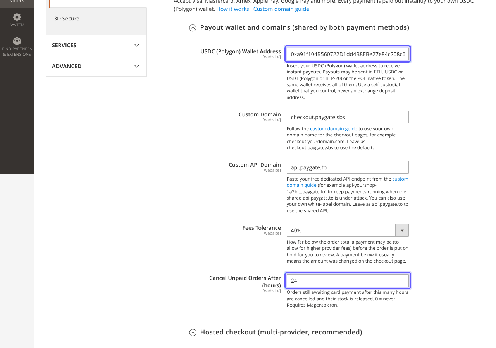
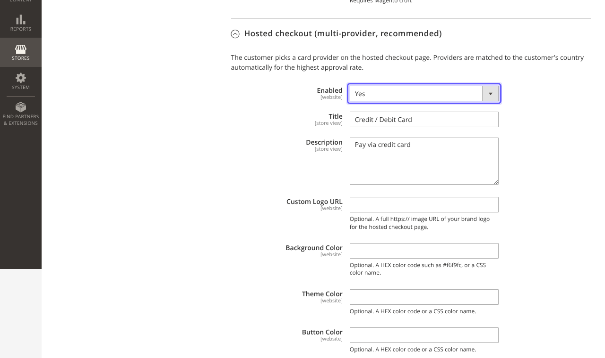
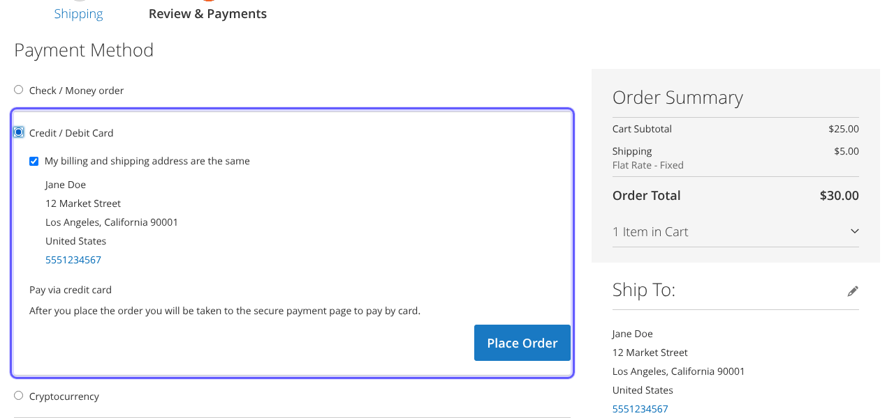
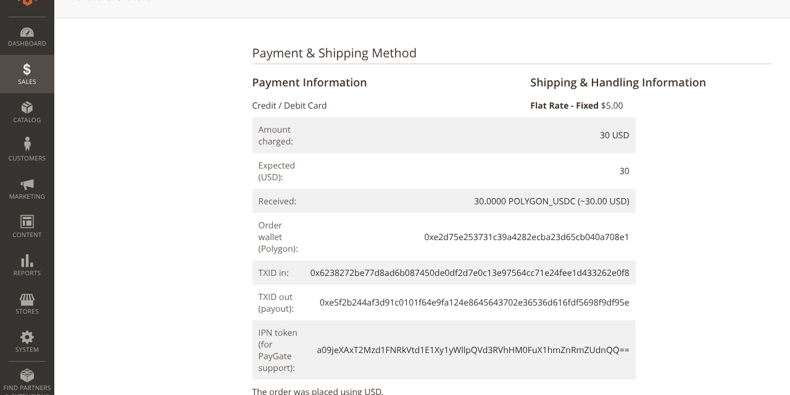

# Magento-Instant-Payment-Gateway
Magento Accept Credit Cards - Google Pay - Apple Pay no KYC

Instant approval card payment gateway for Magento 2 (Magento Open Source, Adobe Commerce and Mage-OS). Accept credit and debit cards, Apple Pay, Google Pay and more with instant payouts to your own USDC wallet. No KYC, no merchant account.

* Instant approval high risk gateway: no sign up, no merchant account and no chargebacks.
* Every payment is paid out instantly to your own USDC (Polygon) wallet. Use a self-custodial wallet that you control.
* **Hosted checkout (multi-provider)**: the customer picks a card provider on the hosted page; providers are matched to the customer's country for the highest approval rate.
* **Single provider**: send the customer straight to one provider of your choice, with a minimum order amount.
* Payments are confirmed by PayGate's signed callback. Every callback is verified (RSA signature over the exact URL, plus a secret per order) before an order is changed.
* Fees tolerance: payments a little below the order total (higher provider fees) are accepted; anything below your tolerance puts the order On Hold for you to review.
* Works with your own dedicated API endpoint and custom checkout domain from the [white label guide](https://paygate.to/white-label-api-custom-domain-guide/).
* Multi-currency: the order is charged in the currency the customer sees.
* 1% + provider fees.

> 🪙 **Want crypto too?** Our free [Magento crypto module](https://paygate.to/crypto-payment-gateway-no-kyc-instant-payouts/magento/) is the only crypto payment gateway with instant payouts for Solana, Monero, Zcash and Bitcoin.

📘 **Step-by-step guide with screenshots:** [https://paygate.to/instant-payment-gateway/magento/](https://paygate.to/instant-payment-gateway/magento/)

# Install Guide

Requires Magento 2.4.4 or newer (Magento Open Source, Adobe Commerce or Mage-OS) with PHP 7.4 or 8.1 to 8.5. Works with the default Luma checkout.

**With Composer (recommended)**

```
composer config repositories.paygate-card vcs https://github.com/paygate-to/Magento-Instant-Payment-Gateway
composer require paygate/module-instant-payment:dev-main
bin/magento module:enable PayGate_InstantPayment
bin/magento setup:upgrade
bin/magento setup:di:compile
bin/magento setup:static-content:deploy
bin/magento cache:flush
```

**Manually**

* Download this repository and copy its files to `app/code/PayGate/InstantPayment/` in your Magento folder.
* Run the same `bin/magento` commands as above (`setup:di:compile` and `setup:static-content:deploy` are only needed in production mode).

# Settings

Go to **Stores >> Configuration >> Sales >> Payment Methods >> PayGate.to Card Payments**.

* **USDC (Polygon) Wallet Address**: the wallet that receives your payouts. The payment methods stay hidden at checkout until it is set.
* **Custom Domain** and **Custom API Domain**: optional, from the [custom domain guide](https://paygate.to/white-label-api-custom-domain-guide/). Leave the defaults to use checkout.paygate.sbs and api.paygate.to.
* **Fees Tolerance**: how far below the order total a payment may be before the order is put On Hold.
* **Cancel Unpaid Orders After**: unpaid orders are cancelled after this many hours (24 by default, 0 = never) and their stock is released. Requires Magento cron.
* **Hosted checkout** and **Single provider**: enable one or both. If you enable both, give them different titles so customers can tell them apart. For a single provider, enter its tag from the [provider list](https://api.paygate.to/control/provider-status/) and its minimum amount in USD.

# How orders are handled

* The payment is created when the customer clicks **Place Order**. If PayGate cannot be reached the order is not placed and the customer sees a message to try again.
* The order is created with the status **Awaiting card payment** (state Pending Payment) and the customer is sent to the payment page. The order confirmation e-mail is sent once the payment is confirmed.
* Paid: the order is invoiced and moves to **Processing**; the order and invoice e-mails are sent.
* Paid below your tolerance: the order is put **On Hold** with a note for you to review.
* Unpaid orders are cancelled after the **Cancel Unpaid Orders After** setting. Magento's generic 8-hour Pending Payment cleanup does not touch them, so a payment still being verified by the provider is not lost. A payment that arrives for a cancelled order is added to the order as a note for you to review.
* A further payment for an order that is already paid is added as a note, so you can refund it.
* The admin order page shows the payment details (amounts, transaction ids, IPN token for PayGate support). Log file: `var/log/paygate_card.log`.

The callback URL (`/paygate/callback/index`) must be reachable from the internet: do not put it behind a password, IP allow-list or maintenance mode. On Adobe Commerce with Website Restrictions enabled, allow this URL for guests.

Full guide: [paygate.to/instant-payment-gateway](https://paygate.to/instant-payment-gateway/)

# Screenshots








